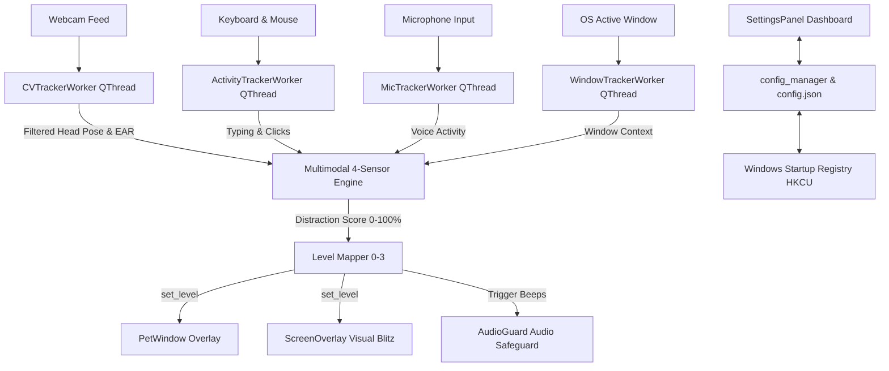

# 🐾 Desktop Focus Pet (Tamagotchi Focus Assistant)

A responsive, interactive desktop pet overlay application built with **PyQt6**, **OpenCV**, and **MediaPipe Face Mesh**. The Focus Pet fuses 4 real-time multimodal sensors (Camera Vision, Keyboard & Mouse Activity, Microphone Voice Detection, and Workspace Window Context) to maintain intelligent focus tracking while giving your desktop a delightful companion.

---

## 🌟 Key Features

- 🧠 **4-Sensor Multimodal Focus Matrix**
  - 🎙️ **Microphone Voice Activity (`mic_tracker.py`)**: Detects active speaking in Zoom/Teams calls, meetings, or dictation (`is_speaking = True`). Active speech maintains focus score at 0.0%.
  - ⌨️ **System Input Activity (`activity_tracker.py`)**: Tracks keyboard typing and mouse movement/clicks via Windows API (`GetLastInputInfo`). Active work overrides minor head movement.
  - 📷 **Ultra-Tolerant Vision Tracking (`cv_tracker.py`)**:
    - **Exponential Moving Average Filter**: Smooths camera angles to remove jitter.
    - **Dynamic Baseline Auto-Centering**: Baseline smoothly follows your natural head pose while working.
    - **Sensitivity Control**: Select between **Relaxed** (default, Yaw 48° / Pitch 36°), **Ultra-Tolerant** (Widescreen, Yaw 60° / Pitch 45°), **Normal**, or **Strict**.
  - 💻 **Active Window Context (`window_tracker.py`)**: Tracks your current active application window.

- 💎 **Ultra-Premium Glassmorphic Dashboard UI**
  - Dark obsidian theme (`#0b0c12`) with translucent glass card containers.
  - Real-time Sensor Matrix Badges for Vision, Keyboard/Mouse, Microphone, Active Window, and Audio Guard.
  - Glowing progress bar with Quick **"Reset Distraction Score (0%)"** button.

- ⚙️ **Automatic Machine Startup (Windows Auto-Start)**
  - Seamlessly managed through the Windows Registry (`HKCU\Software\Microsoft\Windows\CurrentVersion\Run`) with a single toggle in the control dashboard.

- 🐶 **Multi-Pet Selection & Custom Pet Support**
  - **Blob Slime (Classic)**: Morphing gradient slime pet.
  - **Cute Kitty Cat**: Pointed cat ears, inner pink blush, and whiskered cheeks.
  - **Cyber Robot**: Futuristic metallic chassis, glowing top antenna, and neon cyber visor.
  - **Panda Bear**: Cute round panda ears and black eye patches.
  - **Custom Pet**: Load your own custom image (PNG/JPG/GIF) or customize primary and secondary gradient colors!

- 🎭 **4 Tiered Behavioral Intensity Levels**
  - **Level 0 — Focused (0 – 20% Distraction)**: Sleeping pet in bottom corner with floating Zzz bubbles.
  - **Level 1 — Slight Distraction (21 – 50% Distraction)**: Pet walks near cursor with speech bubbles.
  - **Level 2 — Sustained Distraction (51 – 80% Distraction)**: Pet knocks on screen glass creating ripple/crack animations.
  - **Level 3 — Visual Blitz / Total Zone-Out (81 – 100% Distraction)**: Pet shakes violently, red warning flash pulses, and alert popups spawn (acknowledging popups resets score to 0%).

---

## 🏗️ System Architecture



---

## 📁 Repository Structure

```
tomogachi/
├── run.py                 # Application launcher with crash logging
├── main.py                # Redesigned PyQt6 SettingsPanel dashboard & event loop
├── mic_tracker.py         # Voice activity / microphone input detector
├── window_tracker.py      # Active OS foreground application tracker
├── activity_tracker.py    # System-wide keyboard & mouse activity monitor
├── cv_tracker.py          # CVTrackerWorker QThread (Exponential smoothing + PnP)
├── intensity_engine.py    # 4-sensor Multimodal Fused IntensityEngine
├── pet_gui.py             # Multi-pet species renderer, ScreenOverlay & FakePopup
├── config_manager.py      # Windows auto-start registry & JSON settings manager
├── audio_guard.py         # Output device inspector & safe alert tone generator
├── requirements.txt       # Python package dependencies
├── README.md              # Project documentation
└── tests/
    └── test_components.py # Unittest suite (20 test cases)
```

---

## 🚀 Installation & Usage

```bash
# Install Dependencies
pip install -r requirements.txt

# Run Application
.\venv\Scripts\python.exe main.py
```
*(or `python main.py`)*
