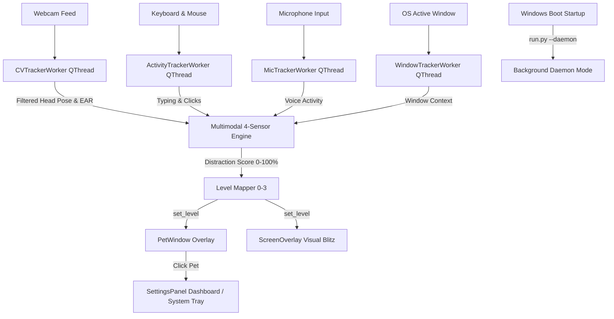

# 🐾 Desktop Focus Pet (Tamagotchi Focus Assistant)

A responsive, interactive desktop pet overlay application built with **PyQt6**, **OpenCV**, and **MediaPipe Face Mesh**. The Focus Pet runs as a silent background daemon with system tray integration and a Codex/VS Code Pets-style click-to-toggle pet overlay.

---

## 🌟 Key Features

- ⚙️ **Background Daemon Mode & System Tray Integration**
  - **Silent Autostart (`--daemon`)**: On Windows startup, the app launches silently as a background process:
    - Floating Pet Overlay: **VISIBLE**
    - Windows System Tray Icon: **ACTIVE**
    - Control Dashboard Window: **HIDDEN** (Zero desktop clutter on boot!).
  - 🖱️ **Pet Click-to-Toggle Dashboard**: Click directly on your floating desktop pet (or system tray icon) to open/toggle the Control Dashboard.
  - 📌 **System Tray Context Menu**: Left-click or right-click the system tray icon to access controls, reset distraction scores, or exit cleanly.

- 🧠 **4-Sensor Multimodal Focus Matrix**
  - 🎙️ **Microphone Voice Activity (`mic_tracker.py`)**: Detects active speaking in Zoom/Teams calls, meetings, or dictation (`is_speaking = True`). Active speech maintains focus score at 0.0%.
  - ⌨️ **System Input Activity (`activity_tracker.py`)**: Tracks keyboard typing and mouse movement/clicks via Windows API (`GetLastInputInfo`). Active work overrides minor head movement.
  - 📷 **Ultra-Tolerant Vision Tracking (`cv_tracker.py`)**:
    - **Exponential Moving Average Filter**: Smooths camera angles to remove jitter.
    - **Dynamic Baseline Auto-Centering**: Baseline smoothly follows your natural head pose while working.
    - **Sensitivity Control**: Select between **Relaxed** (default, Yaw 48° / Pitch 36°), **Ultra-Tolerant** (Widescreen, Yaw 60° / Pitch 45°), **Normal**, or **Strict**.
  - 💻 **Active Window Context (`window_tracker.py`)**: Tracks your current active application window.

- 🐱 **VS Code / Codex Procedural Pets (`pet_sprites.py`)**
  - **The Cyber Cat**: Sharp ears, s-curve reactive tail sway, 4-frame trot cycle.
  - **The Terminal Dragon**: Wing flaps, tail flame tip, smoke & fire particles.
  - **The Mecha Bot**: Floating hover, scanning cyber visor, spinning antenna LED.
  - **Developer Color Palettes**: Tokyo Night, Dracula, Catppuccin, One Dark Pro.

---

## 🏗️ System Architecture



---

## 📁 Repository Structure

```
tomogachi/
├── run.py                 # Application launcher with crash logging
├── main.py                # System Tray Daemon, SettingsPanel dashboard & event loop
├── pet_sprites.py         # Procedural vector pets & interactive preview window
├── pet_gui.py             # Multi-pet species renderer, ScreenOverlay & FakePopup
├── mic_tracker.py         # Voice activity / microphone input detector
├── window_tracker.py      # Active OS foreground application tracker
├── activity_tracker.py    # System-wide keyboard & mouse activity monitor
├── cv_tracker.py          # CVTrackerWorker QThread (Exponential smoothing + PnP)
├── intensity_engine.py    # 4-sensor Multimodal Fused IntensityEngine
├── config_manager.py      # Windows auto-start registry & JSON settings manager
├── audio_guard.py         # Output device inspector & safe alert tone generator
├── requirements.txt       # Python package dependencies
├── README.md              # Project documentation
└── tests/
    └── test_components.py # Unittest suite (21 test cases)
```

---

## 🚀 Installation & Usage

```bash
# Install Dependencies
pip install -r requirements.txt

# Run Normal Mode (Dashboard + Pet)
.\venv\Scripts\python.exe main.py

# Run Background Daemon Mode (Pet + System Tray, Hidden Dashboard)
.\venv\Scripts\python.exe main.py --daemon
```
